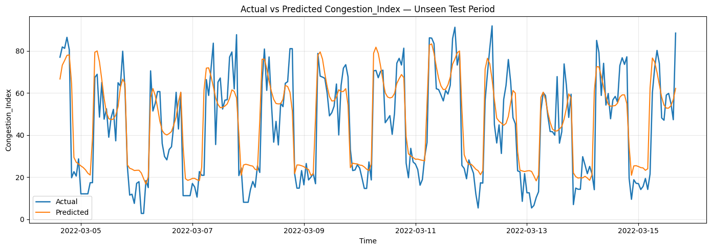
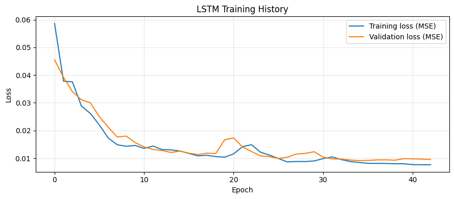
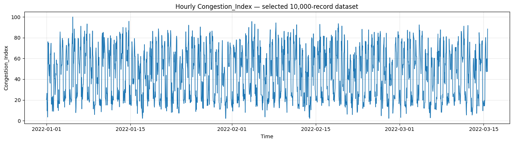

# Emergency Dispatch & Traffic Congestion Forecasting using LSTM

A Kaggle practical that uses historical traffic observations to forecast the next hour’s congestion index with a TensorFlow/Keras LSTM. The objective is to demonstrate time-series preprocessing, sequence construction, model training, evaluation, and result visualization for an emergency-dispatch use case. This notebook is a forecasting prototype; it does not implement live ambulance routing.

## Repository structure

```text
emergency-dispatch-traffic-forecasting/
├── notebooks/
│   └── emergency_dispatch_traffic_forecasting.ipynb
├── results/
│   ├── actual_vs_predicted.png
│   ├── hourly_target_series.png
│   ├── training_loss.png
│   └── test_metrics.json
├── .gitignore
├── README.md
└── requirements.txt
```

## Dataset

- Kaggle dataset: [Emergency Dispatch & Traffic Physics Dataset](https://www.kaggle.com/datasets/razinibabadelatif/emergency-dispatch-and-traffic-physics-dataset)
- The executed notebook selected `synthetic_traffic_benchmark_200k.csv` (200,000 rows and 29 columns) and used 10,000 records.
- The dataset is attached in Kaggle via **Add Input**. It is not included in this repository; do not redistribute the raw data unless its license permits it.
- Timestamp column: `Timestamp`
- Prediction target: `Congestion_Index`

## Methodology

1. Load and inspect the dataset, column types, and missing values.
2. Parse timestamps, sort chronologically, and select the first 10,000 timestamp-valid records.
3. Handle missing values, encode categorical columns, and create cyclic time features.
4. Aggregate observations into hourly values and construct a sequence from the preceding 24 hours to predict the next hour.
5. Scale features using `MinMaxScaler`; fit scalers on the training interval only.
6. Use a chronological split: 70% training, 15% validation, and 15% testing.
7. Train a two-layer LSTM using Adam and mean squared error (MSE), with dropout, early stopping, and learning-rate reduction.
8. Evaluate held-out predictions with MAE and RMSE; create training-loss and actual-versus-predicted plots.

## Model architecture

- Input: 24 time steps × 71 features in the recorded run
- LSTM: 64 units, `return_sequences=True`
- Dropout: 0.20
- LSTM: 32 units
- Dense: 16 units with ReLU activation
- Output: one linear unit for next-hour `Congestion_Index`
- Optimizer: Adam, learning rate 0.001
- Loss: mean squared error (MSE)
- Maximum epochs: 50; batch size: 32; early stopping monitors validation loss

## Results from the saved notebook run

| Item | Result |
|---|---:|
| Raw records used | 10,000 |
| Hourly observations | 1,769 |
| Lookback window | 24 hours |
| Test MAE | 9.4543 |
| Test RMSE | 12.2268 |
| Forecast timestamp | 2022-03-15 17:00 |
| Forecast `Congestion_Index` | 63.0023 |

MAE and RMSE are in the original target units. Lower values are generally better when comparing models on the same target and test set. These figures are the output of the saved run, not a guarantee that rerunning the notebook will produce identical values.

### Actual vs predicted



### Training and validation loss



### Hourly target series



## Run in Kaggle

1. Open [Kaggle Notebooks](https://www.kaggle.com/code).
2. Import `notebooks/emergency_dispatch_traffic_forecasting.ipynb`.
3. Click **Add Input** and attach the dataset listed above.
4. Select a GPU accelerator if available. One T4 GPU is sufficient for this relatively small model; the code does not configure multi-GPU distribution.
5. Run the notebook from top to bottom. Verify the timestamp and target column selection in the schema-inspection output.
6. Download the desired artifacts from `/kaggle/working/`.

For a local Python environment, install the packages in `requirements.txt` and run the notebook in Jupyter. The dataset-loading paths in the notebook are designed for Kaggle; local execution requires setting `INPUT_ROOT` or `DATA_PATH` to a local dataset path.

## Outputs

The notebook writes the trained model (`traffic_congestion_lstm.keras`), fitted scalers, metadata, test metrics, preprocessed hourly data, prediction CSV, and figures under `/kaggle/working/`. Trained model and scaler files are not committed by default because they can be regenerated by running the notebook.

## Limitations and interpretation

- The dataset file is named `synthetic_traffic_benchmark_200k.csv`; these results should not be presented as validation on live road-sensor data.
- The first 10,000 timestamp-valid records are chosen after chronological sorting. This selects an early portion of the dataset’s time coverage, so conclusions may not generalize to all periods.
- Hourly aggregation combines available records into a system-wide series rather than separate road-level models.
- Future accidents, closures, and weather are not known to this one-step model unless future covariates are supplied separately.
- Compare against a persistence baseline (next hour equals the latest observed value) before claiming LSTM superiority.

## Environment used for the saved run

- Python 3.13.15
- TensorFlow 2.20.0 / Keras 3.13.2
- Pandas 2.3.3; NumPy 2.1.3; SciPy 1.16.3
- Kaggle GPU runtime with two Tesla T4 devices detected; the model code does not explicitly distribute training across both devices.
